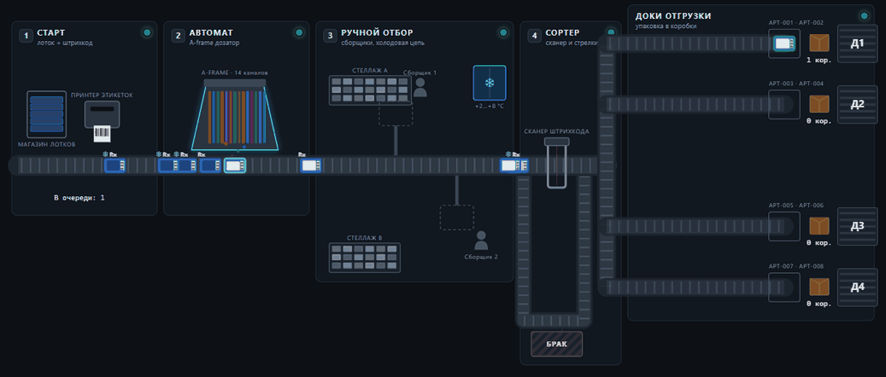
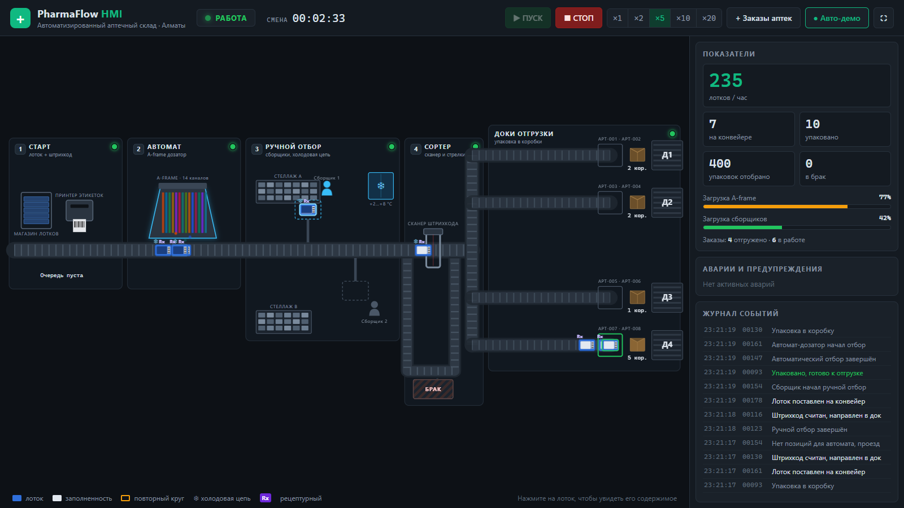
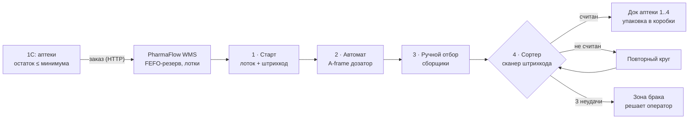

# PharmaFlow

[](https://github.com/RamazanSagynbek/PharmaFlow/actions/workflows/ci.yml)


**Система управления автоматизированным аптечным складом (WMS) с цифровым двойником конвейера.**

Сеть аптек ведёт учёт лекарств. Когда остаток препарата в аптеке падает ниже минимума, автоматически формируется заказ на распределительный склад. Склад резервирует товар по правилу FEFO, раскладывает заказ по лоткам со штрихкодами, и лотки проходят по конвейеру через четыре автоматизированные зоны до дока отгрузки нужной аптеки.



> Статус: **этап 2 из 4.** Готовы бэкенд склада, цифровой двойник конвейера и HMI оператора. Дальше: интеграция с 1С:Предприятие, обмен по промышленному протоколу.

## Быстрый старт

```
start.bat            ← сервер + окно HMI
start-demo.bat       ← режим презентации: конвейер работает, заказы аптек поступают сами
```
или `python start.py [--demo]`. При первом запуске лаунчер создаёт окружение Python, ставит зависимости и собирает HMI (нужны Python 3.12+ и Node.js). HMI открывается отдельным окном без вкладок, по F11 переходит в полноэкранный режим. Если закрыть окно, сервер остановится.

## HMI оператора

Мнемосхема склада в стиле промышленных SCADA (по принципам ISA-101: оборудование в нейтральных серых тонах, цвет обозначает только состояние):

- **Живая схема:** ленты конвейера анимируются, лотки едут по ним в реальном времени (WebSocket, 5 обновлений в секунду), заполняются в автомате и у сборщиков, уходят в доки и упаковываются в коробки.
- **Оборудование:** магазин лотков и принтер этикеток, A-frame на 14 каналов (видно, как падают упаковки), стеллажи и холодильник +2…+8 °C, сборщики на рабочих местах, сканер с лазером, стрелки сортера, повторный круг, зона брака, 4 дока с аптеками маршрута.
- **Лампы зон:** зелёная — норма, жёлтая — очередь или перегрузка, красная — авария.
- **Панель оператора:** ПУСК и СТОП, скорость ×1…×20, KPI (лотков в час, загрузка A-frame и сборщиков), аварии с кнопкой «Разобрать вручную», журнал событий.
- **Карточка лотка:** по клику видны аптека, док, препараты, серии и сроки годности (FEFO) и что уже отобрано.



## Как работает склад



| Зона | Что происходит | Ресурс |
|---|---|---|
| **1. Старт** | Заказ превращается в один или несколько лотков (вместимость 40 упаковок), лоткам печатаются штрихкоды | Индукция: один лоток каждые 4 с |
| **2. Автомат** | Вертикальный дозатор (A-frame) выбрасывает в лоток ходовые таблетки и капсулы | Один автомат, отбор по очереди |
| **3. Ручной отбор** | Сборщик добавляет крупногабаритное, редкое и товары холодовой цепи | N сборщиков (по умолчанию 2) |
| **4. Сортер и доки** | Сканер читает штрихкод, стрелка направляет лоток в док маршрута аптеки, там его упаковывают в коробку | Сканер + упаковочный пост на каждом доке |

## Что внутри

**Фармацевтические правила**
- **FEFO** (First Expired, First Out): первой отгружается серия с ближайшим сроком годности.
- **Минимальный остаточный срок:** серии, у которых до конца срока меньше 90 дней, аптекам не отгружаются.
- **Учёт по сериям:** в каждой позиции лотка записана серия, поэтому при отзыве партии сразу видно, в какие аптеки она ушла.
- **Признаки товара:** рецептурный (Rx) и холодовая цепь (+2…+8 °C), такие товары идут в ручную зону.

**Логика автоматики (как в PLC сортировщика)**
- Штрихкод лотка с контрольной цифрой GS1 mod-10: сканер отличает неверное считывание и не отправит лоток не в ту аптеку.
- Не считал штрихкод → лоток уходит на повторный круг; после 3 неудач → в зону брака, заказ получает статус `exception`.
- Зоны работают как ресурсы с ограниченной ёмкостью, поэтому появляются очереди и узкие места. Видна загрузка автомата и сборщиков и пропускная способность в лотках в час.

**Интеграция и надёжность**
- **Идемпотентный приём заказов:** если 1С повторно отправит тот же документ (`external_id`), склад не соберёт его дважды.
- **Резерв и списание:** при приёме заказа товар резервируется, а списывается только после упаковки в доке.
- **Восстановление после перезапуска:** незавершённые лотки возвращаются в начало конвейера.
- Журнал событий по каждому лотку: сканирования, отбор, упаковка.

## Архитектура

```
frontend/src/              # HMI: React + TypeScript, SVG-мнемосхема
├── hmi/layout.ts          # геометрия схемы: координаты лотка по стадии и прогрессу
├── hmi/equipment.tsx      # графика оборудования (лента, A-frame, сканер, доки…)
├── hmi/Mnemonic.tsx       # мнемосхема целиком
├── useWarehouse.ts        # WebSocket с автопереподключением, журнал, аварии
└── components/            # верхняя панель, KPI и аварии, карточка лотка

backend/app/
├── models.py              # аптеки, товары, серии, заказы, лотки, журнал событий (SQLAlchemy 2.0)
├── barcode.py             # штрихкоды лотков с контрольной цифрой GS1
├── services/
│   ├── allocation.py      # FEFO и раскладка по лоткам (чистые функции)
│   ├── orders.py          # приём заказа: валидация, идемпотентность, резерв
│   └── fulfillment.py     # упаковка, брак, статусы заказа, списание
├── sim/
│   ├── engine.py          # цифровой двойник: конвейер, зоны, сканер (чистый Python, без БД)
│   └── runner.py          # связь симулятора с БД и WebSocket
└── api/                   # REST + WebSocket /ws
```

Симулятор отделён от базы данных: `engine.py` — детерминированная машина состояний, которую легко тестировать. `runner.py` переносит её события в БД и транслирует клиентам.

## Запуск

**Docker (PostgreSQL + API + HMI, симуляция стартует сама):**
```bash
docker compose up --build
# HMI: http://localhost:8000 · Swagger: http://localhost:8000/docs
```

**Вручную, для разработки (SQLite):**
```bash
cd backend
python -m venv .venv
.venv\Scripts\activate          # Linux/macOS: source .venv/bin/activate
pip install -r requirements-dev.txt
uvicorn app.main:app --reload

# HMI с горячей перезагрузкой (во втором терминале)
cd frontend && npm install && npm run dev   # http://localhost:5173
```

**Попробовать:**
```bash
# 1. Сгенерировать заказы аптек (пока вместо 1С)
curl -X POST "http://localhost:8000/api/demo/orders?count=10"
# 2. Запустить конвейер
curl -X POST http://localhost:8000/api/sim/start
# 3. Смотреть состояние склада, метрики и журнал
curl http://localhost:8000/api/sim/state
curl http://localhost:8000/api/metrics
curl "http://localhost:8000/api/events?limit=20"
```

## API

| Метод | Путь | Описание |
|---|---|---|
| `POST` | `/api/orders` | Заказ аптеки (вызывает 1С), идемпотентен по `external_id` |
| `GET` | `/api/orders`, `/api/orders/{id}` | Заказы со строками и лотками |
| `GET` | `/api/stock` | Товары с сериями: срок годности, остаток, резерв |
| `GET` | `/api/totes/{barcode}` | Содержимое лотка с сериями |
| `POST` | `/api/totes/{barcode}/resolve` | Оператор вручную разобрал лоток из зоны брака |
| `GET` | `/api/events` | Журнал событий конвейера |
| `GET` | `/api/metrics` | Статусы заказов и лотков, загрузка зон, лотков в час |
| `POST` | `/api/sim/start` · `/stop` · `/speed` | Управление симуляцией |
| `WS` | `/ws` | Живой поток состояния склада для SCADA-панели |

Пример заказа из 1С:
```json
POST /api/orders
{
  "external_id": "1C-ЗК-000123",
  "pharmacy_code": "APT-005",
  "lines": [{"sku": "MED-0001", "qty": 30}, {"sku": "MED-0028", "qty": 2}]
}
```

## Тесты

```bash
cd backend && pytest
```
38 тестов: FEFO и минимальный срок годности, раскладка по лоткам, контрольная цифра штрихкода, маршрутизация, повторные круги и зона брака, ограничения ёмкости зон, полный сквозной сценарий «заказ → отгрузка → списание», идемпотентность, восстановление после перезапуска. CI гоняет тесты на **SQLite и PostgreSQL**, проверяет типы и собирает HMI, собирает Docker-образ.

## План

- [x] **Этап 1:** WMS-бэкенд, FEFO, лотки и штрихкоды, симулятор конвейера, API, тесты, CI
- [x] **Этап 2:** HMI оператора (React): мнемосхема склада, лотки в движении, аварии, KPI, запуск одной командой
- [ ] **Этап 3:** 1С:Предприятие: аптеки, остатки, минимальный запас → автозаказ → PharmaFlow
- [ ] **Этап 4:** обмен по Modbus TCP или MQTT между симулятором и «контроллером», маркировка DataMatrix, отчёты по сериям

---
Автор: [Ramazan Sagynbek](https://github.com/RamazanSagynbek), КБТУ, «Автоматизация и управление».
Данные демонстрационные: аптеки и GTIN вымышлены.
